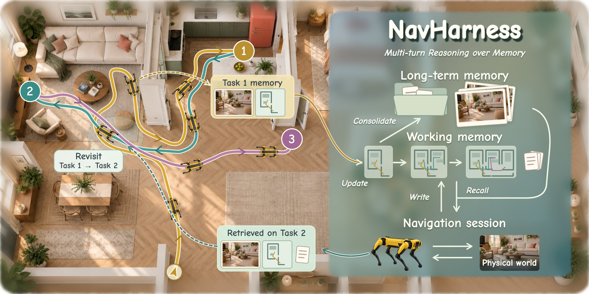
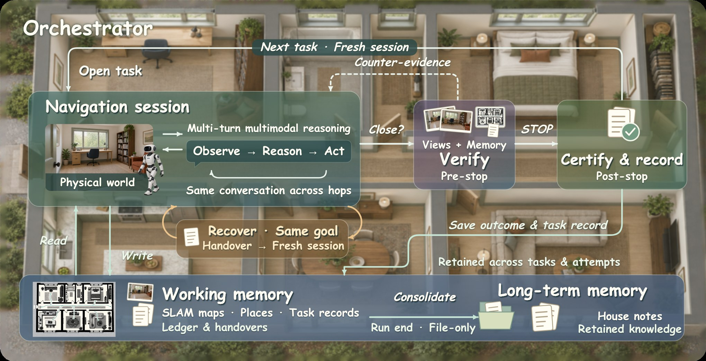
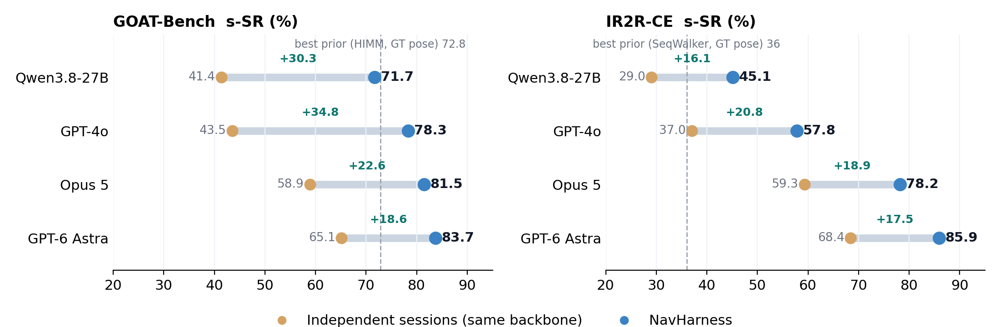
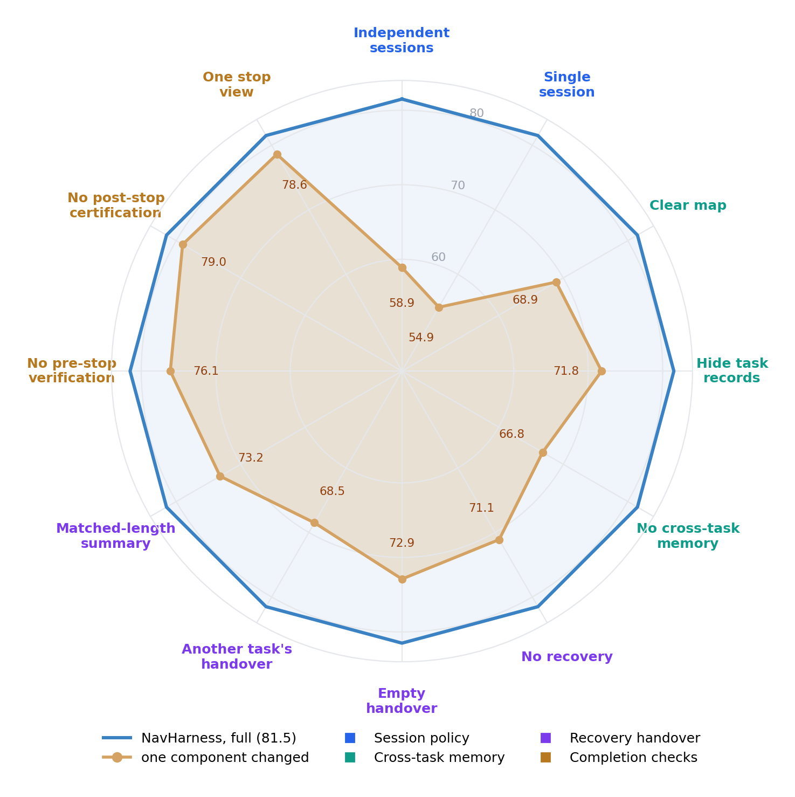
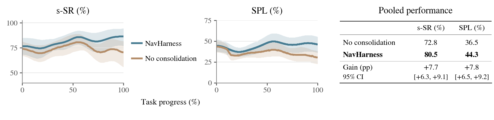

<div align="center">

<h1>NavHarness: Towards Lifelong Embodied Navigation</h1>

Xunyi Zhao<sup>1,2,*</sup>, Jian Zhou<sup>1,*</sup>, Sihao Lin<sup>1,2</sup>, Gengze Zhou<sup>1</sup>, Zerui Li<sup>1</sup>,
Xinyu Yan<sup>1,2</sup>, Jiajun Liu<sup>2,3</sup>, Anton van den Hengel<sup>1,2</sup>, Qi Wu<sup>1,2,†</sup>

<sup>1</sup>Adelaide University &nbsp; <sup>2</sup>Responsible AI Research Centre, Australian Institute for Machine Learning &nbsp; <sup>3</sup>CSIRO Data61
<br><sup>*</sup>Equal contribution &nbsp; <sup>†</sup>Corresponding author

[](https://billzhao1030.github.io/NavHarness/)
[](https://arxiv.org/abs/2609.34276)
[](https://github.com/billzhao1030/NavHarness)
[](https://www.python.org/)
[](LICENSE)

</div>

<p align="center"></p>

<p align="center"><em>NavHarness orchestrates long-horizon embodied navigation through multi-round multimodal reasoning over working memory and house knowledge, retaining experience for successive tasks.</em></p>

## Overview

Frontier models can already solve individual navigation tasks through multi-round multimodal
reasoning with simple tools. Across successive tasks, however, a robot must also rely on an
evolving map and earlier search records, both of which may be incomplete or conflict with what
it now sees.

**NavHarness** is a training-free embodied harness that makes memory processing part of the
navigation loop. Each task, and each recovery attempt, gets a fresh multi-round agentic session;
the robot keeps its position, maps, task records and house notes. Sessions read that experience
through file and map tools, check it against their observations, and record corrections for the
sessions that follow. Outcome verification and run-end consolidation decide what later sessions
inherit.

**Highlights**

- **83.7% s-SR / 36.9% e-SR on GOAT-Bench** and **85.9% s-SR on IR2R-CE** with GPT-6 Astra, using
  SLAM-estimated poses rather than simulator ground truth.
- **+18.6 to +34.8 s-SR** over the same backbone in context-only independent sessions, across four
  reasoning models (Qwen3.8-27B, GPT-4o, Opus 5, GPT-6 Astra).
- **Structured recovery handovers beat length-matched summaries** by 8.3 s-SR points.
- **Consolidation helps beyond retained maps and records**: +7.7 s-SR and +7.8 SPL in continuous
  deployments across 36 houses.

## Method

<p align="center"></p>

The **orchestrator** opens sessions, advances them in bounded hops, and owns every boundary.
Memory is organised in three tiers:

| Tier | Contents | Lifetime |
|:--|:--|:--|
| **Active context** | current goal, reasoning, observations, retrieved information | one attempt |
| **Working memory** | SLAM occupancy maps, named places with photographs, room and floor connections; task records (ledger, task handovers, recovery notes, completion checks) | across tasks and attempts |
| **Long-term memory** | house notes: index, house overview, room notes, navigation skills | across runs; written only by consolidation |

A task moves through five stages:

1. **Start with retained experience.** A new goal opens a fresh conversation that is told which records to read before moving.
2. **Navigate by consulting memory.** Observation, reasoning and action interleave with map queries, file reads and marked places.
3. **Recover with a fresh conversation.** A stuck session writes a recovery note (searched vs. ruled out, untried options); a new attempt at the same goal continues from the same spot.
4. **Check completion.** A separate judge sees four stop views, earlier frames and the map. A contradicting verdict is returned to the navigator once before STOP; certification records the outcome.
5. **Consolidate.** At run end a file-only session rewrites the house notes, separating checked outcomes from claims.

## Results

All results are on the validation-unseen splits, mean over three seeds. NavHarness uses
ORB-SLAM3 poses, with no simulator pose, global navmesh or navigation-specific training.

<p align="center"></p>

### GOAT-Bench

| Method | Backbone | Pose | s-SR | SPL | e-SR |
|:--|:--|:--:|--:|--:|--:|
| SSMG-Nav | Qwen-VL-Plus | GT | 46.5 | 34.1 | 8.6 |
| AstraNav-Memory | Qwen2.5-VL-3B | GT | 62.7 | 56.9 | – |
| GSMem | GPT-4o | GT | 67.2 | 46.9 | – |
| MetaNav | GPT-4o | GT | 71.4 | 51.8 | – |
| HIMM | GPT-4o | GT | 72.8 | 56.1 | – |
| **NavHarness** | Qwen3.8-27B | SLAM | 71.7 | 48.2 | 14.4 |
| **NavHarness** | GPT-4o | SLAM | 78.3 | 57.1 | 26.9 |
| **NavHarness** | Opus 5 | SLAM | 81.5 | 55.0 | 28.6 |
| **NavHarness** | GPT-6 Astra | SLAM | **83.7** | **62.3** | **36.9** |

### IR2R-CE

| Method | Pose | s-SR | SPL | e-SR | t-nDTW |
|:--|:--:|--:|--:|--:|--:|
| MAP-CMA | GT | 35 | 32 | – | 47 |
| OVER-NAV | GT | 35 | 33 | – | 50 |
| SeqWalker | GT | 36 | 34 | – | 52 |
| **NavHarness** (Qwen3.8-27B) | SLAM | 45.1 | 32.0 | 0.0 | 43.2 |
| **NavHarness** (GPT-4o) | SLAM | 57.8 | 45.2 | 13.9 | 52.9 |
| **NavHarness** (Opus 5) | SLAM | 78.2 | 56.9 | 16.7 | 58.1 |
| **NavHarness** (GPT-6 Astra) | SLAM | **85.9** | **76.1** | **27.8** | **64.2** |

Full tables with all baselines and standard deviations are on the
[project page](https://billzhao1030.github.io/NavHarness/#results) and in the [paper](https://arxiv.org/abs/2609.34276).

### What carries navigation across tasks

<table><tr>
<td width="52%"></td>
<td>

GOAT-Bench s-SR with Opus 5 when one component is changed (full harness: 81.5).

- **A longer conversation is not memory.** One session carried across tasks (54.9) does worse
  than a fresh session per task (58.9).
- **Maps and task records both matter.** Removing both costs 14.7 points.
- **Handover content matters.** A matched-length summary trails the structured handover by
  8.3 points; another task's handover is worse than an empty one.
- **Completion checks** add 5.4 (pre-stop) and 2.5 (post-stop) points, and raise record
  accuracy from 82.6% to 90.7%.

</td></tr></table>

### Continuous deployment

Ten GOAT-Bench tours per house are chained across simulated days, with the robot restarted at
each tour's prescribed start. Across 36 houses with Opus 5, run-end consolidation raises s-SR
from 72.8 to 80.5 and SPL from 36.5 to 44.3 over a control that keeps maps and task records.

<p align="center"></p>

Replays of real deployment episodes, with the agent's messages, the notes it opened and the
judge's verdicts, are on the [project page](https://billzhao1030.github.io/NavHarness/#replays).

## Installation

NavHarness runs on Linux with an NVIDIA GPU (headless EGL rendering). A run uses two Python
environments, one Docker image and the command-line tool of a reasoning core:

| Component | What it runs | Where it lives |
|:--|:--|:--|
| Runner | `runner.py`, the harness, the MCP tool bridge | `envs/navharness` (Python 3.10) |
| Simulator server | Habitat-Sim 0.3.3 and the benchmark loaders, in their own process | `envs/habitat` (Python 3.11) |
| SLAM | ORB-SLAM3 RGB-D tracking, CPU only | Docker image `navharness/orbslam3` |
| Reasoning core | Claude Code, the Codex CLI, or a model behind mini-SWE-agent | Node 22 / pip |

Both conda environments are created inside the clone (`envs/`, git-ignored); the Habitat-Sim source
tree (about 3 GB after the build) is cloned beside it. Setup takes about an hour of machine time, mostly
the Habitat build, the ORB-SLAM3 image and the scene downloads (HM3D val, about 5 GB, and the
Matterport3D habitat archive, about 15 GB for all 90 scans, of which IR2R-CE uses 11), plus however
long the HM3D and Matterport3D access requests take to be granted.

### 1. System prerequisites

```bash
sudo apt-get install -y build-essential ninja-build git unzip \
    libegl1-mesa-dev libgl1-mesa-dev libglvnd-dev
```

- **CMake** ≥ 3.12 and < 4 (`cmake --version`). CMake 4 rejects some of Habitat-Sim's bundled dependencies.
- **NVIDIA driver** with EGL (`nvidia-smi` works and `libEGL_nvidia.so.0` is present).
- **Docker**, usable by your user (`docker run hello-world`).
- **conda** (Miniforge recommended):

  ```bash
  curl -sSL -o Miniforge3.sh https://github.com/conda-forge/miniforge/releases/latest/download/Miniforge3-Linux-x86_64.sh
  bash Miniforge3.sh -b -p ~/miniforge3 && rm Miniforge3.sh && ~/miniforge3/bin/conda init bash
  ```

### 2. Clone and create the runner environment

```bash
git clone https://github.com/billzhao1030/NavHarness.git
cd NavHarness
conda create -y -p envs/navharness python=3.10
envs/navharness/bin/pip install -r requirements.txt     # includes thirdparty/EmbodiedScore-envs
envs/navharness/bin/python -m pytest tests -q            # no GPU, data or API key needed
```

`thirdparty/EmbodiedScore-envs` is the benchmark layer: the GOAT-Bench, IR2R-CE and VLN-CE R2R
loaders, metrics and tour protocol on Habitat-Sim, behind a Gymnasium interface (MIT).

### 3. Build the simulator environment

Habitat-Sim 0.3.3 is built once, from the EmbodiedScore-habitat source tree, into `envs/habitat`:

```bash
conda create -y -p envs/habitat -c conda-forge python=3.11 \
    numpy=1.26.4 quaternion attrs pillow=10.4 scipy numba tqdm \
    gitpython imageio imageio-ffmpeg matplotlib pip ninja
git clone --recursive https://github.com/Embodied-Agent-Squad/EmbodiedScore-habitat.git ../EmbodiedScore-habitat
../EmbodiedScore-habitat/build.sh --python "$PWD/envs/habitat/bin/python" --verify    # about 10 minutes
envs/habitat/bin/pip install -e thirdparty/EmbodiedScore-envs
```

`build.sh` compiles with the system `ninja` from step 1 and one job per core; without `ninja` it falls
back to `make -j` with no job limit, which can exhaust memory. Add `--jobs N` with N at most your RAM in
GB / 2 on a machine with less memory than that. `--verify` renders one EGL frame at the end of the build. Check that the runner finds the simulator
interpreter and that Habitat imports:

```bash
envs/navharness/bin/python -c "from core.envserver import resolve_python; print(resolve_python('habitat'))"
envs/habitat/bin/python -c "import habitat_sim, embodiedscore_envs; print(habitat_sim.__version__)"   # 0.3.3
```

IR2R-CE's nDTW matches habitat-lab's to the last digit only with fastdtw's compiled build
(the pure-Python fallback differs by about 1e-4 and prints a warning):
`envs/habitat/bin/pip install cython && envs/habitat/bin/pip install --force-reinstall --no-deps --no-cache-dir --no-binary fastdtw --no-build-isolation fastdtw`
(`--force-reinstall`: the line above has already installed the pure-Python build).

### 4. Build the ORB-SLAM3 image

```bash
bash docker/orbslam3/build.sh      # about 20 minutes; prints "orbslam3 OK" at the end
```

The SLAM server (`exp_workspace/lhnav_es/mcp/_slam_server.py`) is mounted into this image read-only at
run time; nothing from the repository is baked in. Container logs go to `$ORBSLAM3_LOG` (default
`/tmp/orbslam3-<pid>.log`).

### 5. Install the reasoning cores

| Core | `harness=` | Paper models (`model=`) | Install | Authentication |
|:--|:--|:--|:--|:--|
| Claude Code | `navh` | Opus 5 (`opus-5`) | `claude-agent-sdk` (in `requirements.txt`) and the CLI below | run `claude` once and log in (subscription or Console account) |
| Codex CLI | `navhcodex` | GPT-6 Astra (`gpt-6`, with `effort=medium`) | `npm install -g @openai/codex` | `codex login` |
| mini-SWE-agent | `navhmini` | GPT-4o (`gpt-4o`), Qwen3.8-27B (`qwen3.8-27b`) | `mini-swe-agent` (in `requirements.txt`) | `OPENAI_API_KEY` for GPT-4o; a local Ollama for Qwen |

Node 22 without root, for the two command-line tools:

```bash
curl -sS -o- https://raw.githubusercontent.com/nvm-sh/nvm/v0.40.3/install.sh | bash   # then open a new shell
nvm install 22
npm install -g @anthropic-ai/claude-code @openai/codex
```

The Claude Code seat runs on the CLI's own login and removes `ANTHROPIC_API_KEY` from the
environment it hands to its sessions.

**Qwen3.8-27B** is served by a local [Ollama](https://ollama.com) (`curl -fsSL https://ollama.com/install.sh | sh`,
or a user-local copy at `~/ollama/bin/ollama`, which the harness prefers). The model the paper reports
is the Q4_K_M build with its sampling fixed by a seed:

```bash
ollama pull qwen3.8:27b-q4_K_M
printf 'FROM qwen3.8:27b-q4_K_M\nPARAMETER seed 42\nPARAMETER num_ctx 16384\n' > /tmp/Modelfile.qwen
ollama create qwen3.8-27b-q4-std -f /tmp/Modelfile.qwen
```

Before a mini seat runs a local model, the harness checks the server: it starts `ollama serve`
itself with `OLLAMA_CONTEXT_LENGTH=131072` (restarting an `ollama serve` of your own user that runs
without it) and refuses a model whose sampling is not fixed server-side (temperature 0 or a seed),
since unpinned sampling makes no two runs comparable (`core/api/ollama.py`). `OLLAMA_URL` points it
at another server. A Modelfile's `num_ctx` takes precedence over the server's context: the tag
above is served with a 16,384-token window, the setting of the reported runs, and the run summary
records the window in effect (`serving.effective_context`).

### 6. Prepare the data

The simulator reads two roots: `EMBODIEDSCORE_DATA_ROOT` (episodes) and `EMBODIEDSCORE_SCENE_ROOT`
(scenes). Unset, they default to `data/embodiedscore/datasets` and `data/embodiedscore/scenes`
inside the clone. They must look like this:

```
data/embodiedscore/
├── datasets/
│   ├── goat_bench/hm3d/v1/val_unseen/        val_unseen.json.gz + content/<scene>.json.gz (36 scenes)
│   ├── vlnce/R2R_VLNCE_v1-3_preprocessed/    val_unseen/val_unseen.json.gz + val_unseen_gt.json.gz
│   └── ivlnce/                               tours.json + gt_ndtw.json
└── scenes/
    ├── hm3d/val/<NNNNN-scan>/<scan>.basis.glb + .basis.navmesh    (HM3D v0.2: GOAT-Bench)
    ├── hm3d/hm3d_annotated_basis.scene_dataset_config.json        (referenced by every GOAT-Bench episode)
    └── mp3d/<scan>/<scan>.glb + .navmesh                           (Matterport3D: IR2R-CE)
```

The episode files are public; `gdown` fetches the Google Drive files. Run from the clone's root:

```bash
envs/navharness/bin/pip install gdown
GDOWN=envs/navharness/bin/gdown D=data/embodiedscore/datasets S=data/embodiedscore/scenes
mkdir -p $D/vlnce $D/ivlnce $S

# GOAT-Bench episodes (github.com/Ram81/goat-bench), 70 MB
$GDOWN https://drive.google.com/uc?id=1N0UbpXK3v7oTphC4LoDqlNeMHbrwkbPe -O goat-bench.zip
unzip -q goat-bench.zip -d /tmp/goat && mv /tmp/goat/data/datasets/goat_bench $D/goat_bench
rm -rf goat-bench.zip /tmp/goat

# R2R-CE episodes, which IR2R-CE tours are made of (github.com/jacobkrantz/VLN-CE), 262 MB
$GDOWN https://drive.google.com/uc?id=1fo8F4NKgZDH-bPSdVU3cONAkt5EW-tyr -O R2R_VLNCE_v1-3_preprocessed.zip
unzip -q R2R_VLNCE_v1-3_preprocessed.zip -d $D/vlnce && rm R2R_VLNCE_v1-3_preprocessed.zip

# IR2R-CE tour order and t-nDTW reference paths (github.com/jacobkrantz/IVLN-CE), 1 MB + 138 MB
$GDOWN https://drive.google.com/uc?id=1aeMFpDyabpb7nTL-MGCLKsab-otE8Niu -O $D/ivlnce/tours.json
$GDOWN https://drive.google.com/uc?id=1zxApwFsUF0ekPCiB6z0WQLKNBIVdAgOR -O $D/ivlnce/gt_ndtw.json
```

The scenes need the datasets' terms of use accepted.

- **HM3D** (GOAT-Bench): request access to the Habitat-Matterport 3D Research Dataset and create an
  API token at [my.matterport.com](https://my.matterport.com/settings/account/devtools) (Settings →
  Developer Tools). Then, with the simulator environment from step 3:

  ```bash
  envs/habitat/bin/python -m habitat_sim.utils.datasets_download \
      --username <token-id> --password <token-secret> --uids hm3d_val_v0.2 --data-path /path/to/habitat_data
  ln -s "$(readlink -f /path/to/habitat_data/scene_datasets/hm3d)" data/embodiedscore/scenes/hm3d    # …/hm3d/val/00800-TEEsavR23oF/...
  ```

- **Matterport3D** (IR2R-CE): sign the [Terms of Use](http://kaldir.vc.cit.tum.de/matterport/MP_TOS.pdf)
  and send it to matterport3d@googlegroups.com to receive `download_mp.py`; download the habitat
  data (`python2 download_mp.py --task habitat -o /path/to/mp3d`) and link the scans so that
  `data/embodiedscore/scenes/mp3d/<scan>/<scan>.glb` exists. IR2R-CE val-unseen uses 11 of them:
  `2azQ1b91cZZ 8194nk5LbLH EU6Fwq7SyZv QUCTc6BB5sX TbHJrupSAjP X7HyMhZNoso Z6MFQCViBuw oLBMNvg9in8 pLe4wQe7qrG x8F5xyUWy9e zsNo4HB9uLZ`.

### 7. Verify the installation

Each command needs one more component than the one before:

```bash
PY=envs/navharness/bin/python
# the simulator, the data, SLAM and the tool bridge, driven by the real CLI against a scripted
# endpoint: no model is called and no tokens are spent
$PY runner.py std_goat_slam_es_lhnav harness=navh model=opus-5 api=fake run.episodes=0
# one real GOAT-Bench episode (5-10 tasks)
$PY runner.py std_goat_slam_es_lhnav harness=navh model=opus-5 run.episodes=0
```

The first takes about a minute and needs no login. It ends with
`[std] run complete -> outputs/navharness/fakeapi_goat_slam_es_navh_opus-5_default_lhnav/summary.json`
and a score of 0: the scripted endpoint takes three steps and stops. Lines saying
`⚠ claude.ai connectors are disabled because ANTHROPIC_API_KEY …` are expected there. A run over part of
the episodes is named `test_…` (the second command writes `outputs/navharness/test_goat_slam_es_navh_opus-5_default_lhnav`).

<details>
<summary><b>Troubleshooting</b></summary>

| Symptom | Fix |
|:--|:--|
| `env.python='habitat': no interpreter at …` | step 3 was skipped, or pass `env.python=/abs/path/to/python` |
| `build.sh`: `need CMake >= 3.12 and < 4` | point it at an older CMake: `--cmake /usr/bin/cmake` |
| `import habitat_sim` fails with `CXXABI` or `cannot retrieve OpenGL version` | rebuild with EmbodiedScore-habitat's `build.sh`, not upstream's |
| `500 Server Error … /configure` (or `/place`, `/step`) | the simulator server failed: read `env_server.log` in the run directory |
| `SlamDied` / tracking never starts | check `docker images navharness/orbslam3` and `$ORBSLAM3_LOG` (`permission denied … docker.sock`: Docker is not usable by your user) |
| `claude`: `/usr/bin/env: 'node': No such file or directory` | a system-wide install shadows the nvm one; check `which claude` |
| `codex: command not found` from scripts or ssh only | nvm loads in interactive shells only: `export NVM_DIR=~/.nvm; . ~/.nvm/nvm.sh` first |
| `… serves with sampling (ollama defaults)` | create the seeded tag of step 5 and use it |
| `no GOAT-Bench data at …` | the data roots of step 6, or set `EMBODIEDSCORE_DATA_ROOT` / `EMBODIEDSCORE_SCENE_ROOT` |

</details>

## Usage

### Running an experiment

An experiment is one YAML file in `exp_workspace/lhnav_es/configs/`. The command line picks the
harness, the model, and optionally the endpoint and reasoning effort. Every `python` below is the
runner environment's: `conda activate ./envs/navharness` first, or write `envs/navharness/bin/python`.

```bash
python runner.py <experiment> harness=<harness> model=<model> [api=native|fake] [effort=<level>] [overrides...]
```

| Experiment | Benchmark |
|:--|:--|
| `std_goat_slam_es_lhnav` | GOAT-Bench, val-unseen: all 360 episodes in 36 scenes (2,669 tasks) |
| `std_ivlnce_tour_slam_es_lhnav` | IR2R-CE, val-unseen: all 36 tours in 11 scenes (1,824 tasks) |

```bash
python runner.py std_goat_slam_es_lhnav harness=navh      model=opus-5                 # Opus 5 on Claude Code
python runner.py std_goat_slam_es_lhnav harness=navhcodex model=gpt-6 effort=medium    # GPT-6 Astra on Codex
python runner.py std_goat_slam_es_lhnav harness=navhmini  model=gpt-4o                 # GPT-4o on mini-SWE-agent
python runner.py std_goat_slam_es_lhnav harness=navhmini  model=qwen3.8-27b            # Qwen3.8-27B on mini-SWE-agent
python runner.py std_ivlnce_tour_slam_es_lhnav harness=navh model=opus-5               # IR2R-CE tours
```

The defaults are the paper's reference configuration: 500 movement actions and 200 model turns per
task (a recovery spends from the same budget), hops of 25 turns, recovery after 80 turns on one
attempt or on request (at most one per task), pre-stop verification and post-stop certification by
the navigator's own model with four stop views, and run-end consolidation. Each GOAT-Bench episode
and each IR2R-CE tour starts with an empty memory. The agent's pose, map and markers come from
ORB-SLAM3; the simulator's pose is used only to score.

Common overrides:

| Override | Effect |
|:--|:--|
| `run.episodes=0-9` | run selected episodes (a range or a single index), e.g. for a quick check; the run is named `test_…` |
| `run.resume=true` | continue an interrupted run in the same output directory |
| `run.dry_run=true` | print the resolved configuration and exit |
| `suffix=_s2` | a repeat of the same configuration (the paper's seeds: none, `_s2`, `_s3`) in its own run directory |
| `effort=high` | the vendor's reasoning-effort level |
| `env.port=9300` | move the simulator server when running several experiments at once |
| `api=fake` | the scripted endpoint: every component but the model, at no cost |

### Reproducing the paper

Every reported configuration is the reference plus `harness.*` overrides, for any harness and
model; give each its own `suffix=` so its runs get their own directory. Scores and intervals come
from the [reporters](#scores-and-statistics).

**Main results** (the GOAT-Bench and IR2R-CE tables): for each core, the full harness and the same backbone in
independent sessions, on both experiments.

| Row | Overrides |
|:--|:--|
| NavHarness | none |
| Independent sessions | `harness.session_mode=independent harness.precheck=none` |

**Component comparisons with Opus 5** (`harness=navh model=opus-5`):

| Group | Row | Overrides |
|:--|:--|:--|
| | NavHarness (full reference) | none |
| A. Session policies | Independent sessions | `harness.session_mode=independent harness.precheck=none` |
| | Single session | `harness.session_mode=single harness.precheck=none` |
| | Independent sessions + pre-stop verification | `harness.session_mode=independent harness.precheck=model` |
| B. Cross-task memory | Clear map after each task (keep records) | `harness.persist_map=false` |
| | Hide earlier task records (keep map) | `harness.ledger=none` |
| | No cross-task memory | `harness.persist_map=false harness.ledger=none` |
| C. Recovery handovers | No recovery (same task budget) | `harness.recovery=false` |
| | Recovery + empty handover | `harness.recovery_handover=empty` |
| | Recovery + another task's handover | `harness.recovery_handover=other harness.recovery_handover_bank=<reference run>` |
| | Recovery + matched-length summary | `harness.recovery_handover=summary harness.recovery_handover_bank=<reference run>` |
| D. Completion checks | No pre-stop verification | `harness.precheck=none` |
| | No post-stop certification | `harness.certify=none` |
| | One stop view instead of four | `harness.stop_views=1` |

**Appendix comparisons:**

| Table | Row | Command |
|:--|:--|:--|
| Fixed-access memory | BM25 retrieval in place of the session's own reading | `harness=navh model=opus-5 harness.retrieval=bm25` |
| Cross-model judging | Qwen3.8-27B navigator, Opus 5 judge | `harness=navhmini model=qwen3.8-27b harness.judge_model=claude-opus-5 harness.judge_transport=sdk-session` |
| | Opus 5 navigator, Qwen3.8-27B judge | `harness=navh model=opus-5 harness.judge_model=ollama_chat/qwen3.8-27b-q4-std harness.judge_transport=mini-session` |
| Continuous deployment | 36 houses, with and without consolidation | `scripts/deploy.py`, [below](#continuous-deployment) |

The pre-stop gate diagnostics, completion-check accuracy, per-modality and per-position success,
and the token and turn accounting are computed from the reference runs by `reporting/summarize.py`.

What the switches do:

- `session_mode=independent` opens a fresh session for every task with the observation and action
  tools only (`observe`, `step`, `get_goal`, `close_task`): no files, map, markers, recovery,
  post-stop certification or consolidation. `session_mode=single` gives the same tools in one
  session carried across tasks, compacted by the backend when its context window fills
  (mini-SWE-agent has no compaction of its own, so on `navhmini` it runs until the context is
  full). The pre-stop check follows `precheck` in both.
- `ledger=none` withholds earlier tasks' records (the ledger, handovers, task files and journal)
  from the required reading and the file tools, which then read only the current task's
  directory; on Claude Code the CLI's own `Read` / `Glob` / `Grep` are not opened on the house
  notes either. The harness still writes the records, for scoring.
- `persist_map=false` rebuilds the map and markers at every task boundary, and the place graph
  built from those markers goes with them.
- `recovery=false` switches off requested and fallback recoveries alike; the task keeps its 200
  turns and 500 actions. `<reference run>` is the output directory of a run with the default
  handover (`outputs/navharness/<run name>`): its `lessons.jsonl` files hold the structured notes
  that `other` lends (always one written for a different goal) and whose mean length in words the
  `summary` handover is cut to. Under `other` the attempt still writes its own note, so both cost
  the same. `recovery_escalation=false` applies a repeated recovery at the scope decided for it
  instead of one rung higher; with one recovery per task, escalation never comes into play.
- `retrieval=bm25` takes the choice of what to read away from the session: the harness retrieves
  BM25 excerpts of the earlier records and house notes (400-token chunks with a 50-token overlap,
  up to five within 2,000 tokens, each with its source and recorded status) at task start, after a
  recovery and every ten turns, with the goal and the session's latest description of what it sees
  as the query, and puts them in its next message. It implies `ledger=none`
  (`core/harnesses/navh/memory/retrieval.py`).
- `judge_model` / `judge_transport` move both completion checks to another model on another core;
  the navigator, its recovery notes, the wake-up and the consolidation stay its own. The run is
  named for its judge (`…_judge-claude-opus-5-sdk`), so it never shares a directory with the
  own-judge run.

### Continuous deployment

`scripts/deploy.py` chains the ten GOAT-Bench tours of each house over simulated days, two a day
for five days. Within a day the robot is placed at the next tour's start with its map kept and
turns once in place so the tracker can relocalise; between days the run ends, and the next day
opens on the map and the house notes the house kept, starting with four views of where the robot
was put down.

```bash
python scripts/deploy.py --harness navh --model opus-5 --houses 4ok3usBNeis       # one house
python scripts/deploy.py --harness navh --model opus-5 --all --parallel 4         # all 36 houses
python scripts/deploy.py --harness navh --model opus-5 --all --no-consolidation   # without consolidation
python scripts/deploy.py --harness navh --model opus-5 --all --dry-run            # print the plan
```

Without consolidation, maps, markers and task records are kept across days exactly the same, but no
house notes are written. Everything a deployment produces lives under `--out` (default
`outputs/deploy/<tag>/`): `memory/<house>/` (house notes and journal), `maps/<house>.pkl` and
`runs/<run name>/` (one per day).

### Adding a model

Models are rows of `exp_workspace/lhnav_es/configs/models/models.yaml`, mapping a short name to the
identifier each harness needs:

```yaml
my-model:
  navhmini: {id: openai/my-model, api_base: https://my-endpoint/v1}   # any litellm id
```

Then run with `model=my-model`.

### Outputs

Each run writes to `outputs/navharness/<run name>/`:

```
summary.json          resolved configuration, aggregate metrics, per-task metrics with ground truth
episode_<i>.jsonl     event stream: every message, tool call, recovery, verdict and task boundary
live_<i>/             the camera frames the model was shown
navh_<i>/
  summary.json        one row per task: outcome, verdict, turns, steps, tokens by session, recoveries
  episode_<k>.jsonl   task k's event stream (messages, tool calls, verdicts), live_<k>/ its frames
  trace/              every session's prompts and replies, hop by hop
  lessons.jsonl       the recovery notes, one per recovery
  workspace/run/      this run's task records: the ledger, each task's goal, handover,
                      recovery notes and verdict
  memory/<house>/     the house notes (a deployment keeps them under outputs/deploy/<tag>/memory):
    MEMORY.md         the index
    house.md          the house overview
    rooms/            room notes, and each marked place's photo set (rooms/<room>/photos/,
                      one view per heading with its SLAM pose, indexed in photos.json)
    skills/           navigation skills
    journal/<day>.md  one line per closed task, with the completion check's label
```

Ground truth is recorded under `metrics.truth` for each task (and, for a refused stop, under the
task's `precheck.refusals`) and is never shown to the agent.

### Scores and statistics

`reporting/summarize.py` scores runs the way the paper does: s-SR and SPL pooled over every task,
e-SR as the fraction of episodes (or tours) in which every task succeeds, and IR2R-CE's t-nDTW per
tour. A sequence cut short by the wall-clock limit still counts, its unfinished tasks as failures.
Given the three seeds of a configuration it adds their mean and standard deviation. Per task it
reports model turns, steps, markers, the peak prompt, tokens by session (navigation, recovery
notes, verification, certification, wake-up; consolidation per episode), wall time and recoveries
by trigger, and it prints certification accuracy and κ, success after a false record, success by
goal modality and by task position, and the pre-stop gate table (refused first stops, correct
refusals, rescues and harms, from the truth recorded at each refusal).

```bash
python reporting/summarize.py outputs/navharness/std_goat_slam_es_navh_opus-5_default_lhnav{,_s2,_s3}
```

`reporting/paired_ci.py` gives the paired change between two configurations with its 95% interval:
tasks paired by scene, episode and sub-goal, seeds pooled, 5,000 scene-clustered bootstrap
resamples. A directory of runs counts as one replicate, so a deployment's houses are the resampling
unit:

```bash
python reporting/paired_ci.py --base outputs/navharness/std_goat_slam_es_navh_opus-5_default_lhnav{,_s2,_s3} \
    --compare outputs/navharness/std_goat_slam_es_navh_opus-5_default_lhnav_fixed{,_s2,_s3}
python reporting/paired_ci.py --base outputs/deploy/nocons/runs --compare outputs/deploy/full/runs
```

## Code map

The paper describes NavHarness as six components. Where each lives:

| Component | Code |
|:--|:--|
| The loop | `core/harnesses/navh/orchestrator/orchestrator.py` (seat, task, seam, close; hops) and `session/` (one class per session kind; `session/wire/` holds the Claude Code, Codex and mini-SWE-agent backends) |
| Tool registry | `core/harnesses/navh/bridge/` (the MCP tools a session is given) and `exp_workspace/lhnav_es/mcp/navh_bridge.py` (the benchmark's side) |
| Context policy | `SessionConfig.session_mode` / `compact` and the session opening in `orchestrator.py`; `memory/retrieval.py` for fixed access |
| Memory | `core/harnesses/navh/memory/` (workspace and task records, house notes, place graph) and the SLAM map in `exp_workspace/lhnav_es/mcp/` (`_slam_env.py`, `_mapping.py`) |
| Hooks | `orchestrator/recovery/` (the recovery ladder, the λ note, the wake-up) and the task boundary in `orchestrator.py` |
| Verification | `orchestrator/judge.py` and `session/judge.py` (pre-stop verification and post-stop certification) |

```
core/harnesses/navh/          the harness (its own README describes every module)
core/harnesses/navharness.py  the harness's adapter: every harness.* switch
core/api/                     endpoints: the scripted fake, gateways, local serving checks
exp_workspace/lhnav_es/       the experiment configurations and the GOAT-Bench / IR2R-CE arm
                              (simulator server, SLAM stack, occupancy map, tool bridge)
thirdparty/EmbodiedScore-envs the benchmark layer (GOAT-Bench, IR2R-CE, VLN-CE R2R on Habitat-Sim)
scripts/deploy.py             continuous deployment over simulated days
reporting/                    the paper's scores, accounting and paired intervals
docker/orbslam3/              the ORB-SLAM3 image
runner.py                     entry point
```

## Acknowledgements

NavHarness builds on [Habitat-Sim](https://github.com/facebookresearch/habitat-sim),
[ORB-SLAM3](https://github.com/UZ-SLAMLab/ORB_SLAM3) (GPLv3; built into the Docker image, not
distributed here), [GOAT-Bench](https://github.com/Ram81/goat-bench),
[VLN-CE](https://github.com/jacobkrantz/VLN-CE), [IVLN-CE](https://github.com/jacobkrantz/IVLN-CE),
[mini-SWE-agent](https://github.com/SWE-agent/mini-swe-agent), and the coding-agent sessions of
Claude Code and the Codex CLI.

## Citation

```bibtex
@misc{zhao2026navharness,
  title  = {NavHarness: Towards Lifelong Embodied Navigation},
  author = {Zhao, Xunyi and Zhou, Jian and Lin, Sihao and Zhou, Gengze and Li, Zerui and
            Yan, Xinyu and Liu, Jiajun and van den Hengel, Anton and Wu, Qi},
  year   = {2026},
  eprint = {2609.34276},
  archivePrefix = {arXiv},
  primaryClass  = {cs.RO}
}
```

## License

This project is released under the [MIT License](LICENSE).
